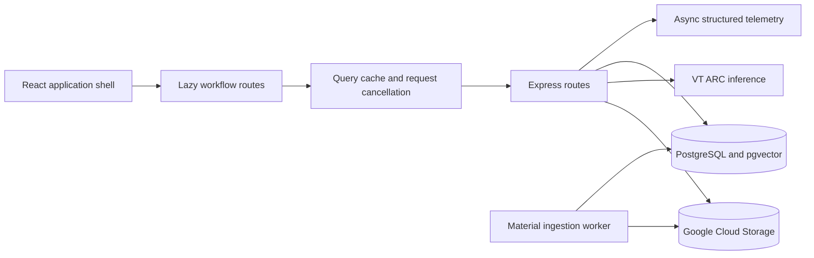

# Application Performance and UI/UX Implementation Plan

**Target:** Department pilot with tens of courses and hundreds of students
**Branch policy:** Integrate into `dev`; do not modify `main` without explicit authorization
**Purpose:** Define implementation-ready tasks that can be assigned independently to subagents
**Scope:** Runtime performance, perceived responsiveness, frontend architecture, visual consistency, accessibility, and the highest-value user workflows

This document is a plan, not a progress tracker. Task IDs express dependencies and ownership; they do not indicate completion status.

## 1. Desired outcomes

The work should produce an application that:

1. Navigates quickly because large routes load only when needed and server data is cached, deduplicated, and cancelled when stale.
2. Handles concurrent users without synchronous file I/O, avoidable query amplification, or unbounded list responses.
3. Gives immediate, honest feedback during long RAG operations without showing unvalidated model output.
4. Uses one coherent visual language across student, professor, and root workflows.
5. Supports keyboard, screen-reader, reduced-motion, mobile, tablet, and desktop use.
6. Measures performance before and after changes so optimizations are based on evidence.

## 2. Constraints and non-goals

### Architectural invariants

- Course chat remains source-only. It must not add web search, general-knowledge fallback, confidence percentages, or the retired scoring pipeline.
- Retrieval remains scoped to authorized, currently published course evidence. Both vector and lexical retrieval must enforce access constraints.
- Generated answers remain structured and server-validated. Raw model tokens must not be shown before evidence and citation validation succeeds.
- Answer text, evidence manifests, and citations remain transactionally persisted after fresh authorization and publication checks.
- The exact filtered pgvector path remains the default until load and answer-quality measurements justify a different index strategy.
- OCR remains disabled. UI changes must continue to describe scanned/image-only documents accurately.
- Material ingestion remains a separate worker process. The API must not process ingestion jobs during startup or request handling.
- VT ARC credentials remain server-only and must never appear in browser bundles, responses, logs, screenshots, or fixtures.
- `backend/dist/` is generated output. Subagents edit `backend/src/` and run the build for verification, but do not commit generated files.

### Non-goals

- Replacing React, Express, PostgreSQL, pgvector, GCS, or VT ARC.
- Changing the embedding model, embedding dimension, chunking model, or reranker without a separate retrieval evaluation.
- Rewriting every page at once.
- Adding OCR or a vision fallback.
- Introducing microservices for the department-pilot scale.
- Redesigning grading policy, course authorization, or user roles.

## 3. Baseline and performance budgets

Task `OBS-01` records the baseline before feature changes. Store measurements in a dated report under `docs/performance/`; never use production student content in benchmarks.

| Area | Measurement | Acceptance budget |
|---|---|---|
| Initial frontend | Built entry chunk and total eager JavaScript | Entry chunk at least 25% smaller than baseline; every large authenticated page emitted as a lazy route chunk |
| Navigation | Time from route selection to usable cached screen | Cached route usable within 200 ms on the benchmark machine |
| Request behavior | Duplicate GETs for the same resource during one navigation | Zero avoidable duplicates after query-cache migration |
| Backend concurrency | Event-loop delay and request p50/p95 under pilot load | No synchronous request-path file I/O; p95 for ordinary list/detail routes improves from baseline with no error-rate regression |
| Database | Query count and duration for chat session/message reads | Constant query count per request; no per-row authorization or citation query |
| Lists | Payload size and database scan growth | All potentially growing lists are bounded and return cursor metadata |
| Chat feedback | Submit to visible student message and stage feedback | Local message visible in the next render; server stage feedback normally begins within 250 ms |
| RAG correctness | Retrieval/citation regression suite and instructor eval set | No authorization, citation-integrity, support, or abstention regression |
| Accessibility | Automated and manual checks on critical workflows | No serious/critical axe violations; all critical workflows keyboard-completable |
| Responsive UI | 360 px, 768 px, 1280 px, and 1440 px viewports | No clipped primary actions, horizontal page overflow, or inaccessible dialogs |

If a numerical target cannot be evaluated reliably in the local environment, report the baseline, test conditions, and relative change instead of inventing a result.

## 4. Target shape



The frontend should expose a small data-query interface rather than repeating Axios, loading, error, refresh, and cancellation behavior in every page. The backend should expose bounded list interfaces and perform authorization in set-based database queries where possible. Shared UI modules should hide interaction, focus, responsive, and visual rules behind small interfaces.

## 5. Subagent execution model

### Working rules

Each task packet should be one reviewable commit unless its packet explicitly allows two commits. Use a short three-to-four-word commit message. Every subagent must:

1. Start from the current `dev` commit and read `CLAUDE.md` plus this plan.
2. Work in a dedicated worktree or on files exclusively assigned by the orchestrator.
3. Avoid reverting or formatting unrelated local changes.
4. Never read or print secret values from `.env`.
5. Add meaningful tests at the public interface being changed; do not mirror implementation details.
6. Run the task-specific checks and relevant package build before handoff.
7. Hand back files changed, migrations added, commands run, results, and material risks.
8. Leave `backend/dist/`, credentials, generated reports, screenshots with user data, and model caches uncommitted.

### Parallel waves

| Wave | Parallel tasks | Integration rule |
|---|---|---|
| 0 | `OBS-01` | Baseline first; it defines evidence for later tasks |
| 1 | `BE-01`, `BE-02`, `FE-01` | Separate backend logging, chat-query, and route-loading ownership |
| 2 | `BE-03`, `FE-02`, `UI-01` | Integrate database response contracts before migrating affected screens |
| 3 | `UI-02`, `UX-01`, `UX-02` | Shared UI modules land before workflow redesigns consume them |
| 4 | `UX-03`, `UX-04`, `BE-04` | Coordinate any shared route or migration files through the integrator |
| 5 | `QA-01`, `QA-02`, `OPS-01` | Stabilization, performance comparison, and deployment workflow |

Do not run two agents against `frontend/src/App.tsx`, `frontend/src/services/api.ts`, `backend/src/routes/chat.ts`, `backend/src/index.ts`, or `backend/src/db/migrations/runMigrations.ts` at the same time. Migration authors create separate additive SQL files; the integrator registers them in order.

## 6. Phase 0: Measurement and safety rails

### OBS-01: Establish repeatable performance baselines

**Objective:** Measure real bottlenecks and create repeatable checks without recording private course content.

**Primary files:**

- `backend/src/index.ts`
- `backend/src/config/database.ts`
- New `backend/src/middleware/requestTelemetry.ts`
- New `backend/src/scripts/benchmarkRoutes.ts`
- `frontend/src/main.tsx`
- New `frontend/src/performance/reportWebVitals.ts`
- `backend/package.json`, `frontend/package.json`
- New `docs/performance/README.md`

**Implementation:**

1. Add request IDs and `Server-Timing` values for total route duration. Preserve an incoming valid request ID or generate one; return it in the response.
2. Record structured fields only: request ID, method, normalized route, status, duration, response size, and authenticated user ID only when required for operations. Do not record authorization headers, cookies, request bodies, prompts, answers, excerpts, filenames, or signed URLs.
3. Add database pool-wait, event-loop delay, and RAG stage durations to structured operational telemetry. Reuse the existing retrieval and generation duration metadata rather than timing the same work twice.
4. Add frontend Core Web Vitals collection using the supported `web-vitals` interface. Development mode may log metrics; production sends a small sampled payload to an authenticated telemetry route with no page content.
5. Add a synthetic benchmark script for health, course lists, chat-session lists, and message reads against a seeded non-production database. Make concurrency, duration, base URL, and bearer token explicit command arguments; never hard-code credentials.
6. Document bundle-size collection, browser conditions, database fixture size, benchmark commands, and how to compare two runs.

**Acceptance criteria:**

- A developer can collect the same backend, database, bundle, and Web Vitals measurements twice under documented conditions.
- Telemetry redaction tests prove secrets and request bodies are excluded.
- Instrumentation adds no synchronous I/O and no new unauthenticated diagnostics route.
- `/api/health` remains liveness-only and `/api/ready` keeps its existing meaning.

**Validation:**

```powershell
cd backend
npm test
npm run build

cd ../frontend
npm run build
```

**Suggested commit:** `Add performance baselines`

## 7. Phase 1: Backend throughput and bounded data access

### BE-01: Replace synchronous and duplicate request logging

**Objective:** Remove event-loop blocking and produce one safe structured request record.

**Primary files:**

- `backend/src/index.ts`
- New `backend/src/config/logger.ts`
- New `backend/src/middleware/requestLogger.ts`
- `backend/package.json`

**Implementation:**

1. Replace `fs.writeFileSync` and `fs.appendFileSync` in the request path with a production-suitable asynchronous structured logger such as `pino`/`pino-http`.
2. Emit logs to stdout for deployment collection. If local file output is retained, use one non-blocking destination stream configured outside request handling.
3. Remove duplicate Morgan and custom request records so one request produces one completion record.
4. Add field-level redaction for authorization, cookies, passwords, tokens, query secrets, signed GCS URLs, prompts, answers, and document content.
5. Keep safe generation failures observable through error type, safe code, upstream status, request ID, and duration.
6. Flush logs during graceful shutdown without delaying normal responses.

**Acceptance criteria:**

- No synchronous filesystem call occurs at startup request registration or inside request middleware.
- One normal request produces one structured completion record with a request ID.
- Unit tests cover redaction and safe error serialization.
- Existing auth, readiness, material upload, and chat route behavior is unchanged.

**Validation:** Backend tests/build plus a 60-second synthetic concurrency comparison against the `OBS-01` baseline.

**Suggested commit:** `Stream structured request logs`

### BE-02: Remove chat authorization and citation query amplification

**Objective:** Make session and message reads use a constant number of database queries.

**Primary files:**

- `backend/src/routes/chat.ts`
- `backend/src/services/rag/access.ts`
- `backend/src/services/rag/CitationService.ts`
- New or existing chat/CitationService tests

**Implementation:**

1. Express accessible chat-session rules in the session-list SQL query using enrollment and course-instructor relationships. Do not fetch all sessions and call `assertCourseAccess` in a loop.
2. Replace per-agent-message `getAuthorizedAnswerRecord` calls with a bulk citation read for the page of message IDs.
3. Preserve the behavior that revoked/deleted material withholds historical answer content and citations.
4. Keep source access decisions on the server; do not trust citation metadata already stored in message JSON.
5. Return message sources in the message-list response so `MessageMetadata` does not immediately refetch sources already authorized for that response.
6. Add query-count assertions through an instrumented test pool or a narrow repository interface.

**Acceptance criteria:**

- Session-list query count does not grow with the number of sessions.
- Message-list query count does not grow with the number of agent messages or citations.
- Student, professor-owner, root, unenrolled, deleted-material, and soft-deleted-message cases retain correct behavior.
- Existing citation excerpts and locators still come from immutable persisted evidence.

**Validation:** Focused chat/RAG tests, database integration tests through `RAG_TEST_DATABASE_URL`, full backend build.

**Suggested commit:** `Batch chat authorization queries`

### BE-03: Add cursor pagination, search, and supporting indexes

**Objective:** Bound every collection that can grow with users, courses, materials, messages, or submissions.

**Primary files:**

- `backend/src/routes/chat.ts`
- `backend/src/routes/root.ts`
- `backend/src/routes/professor.ts`
- `backend/src/routes/student.ts`
- `backend/src/middleware/validation.ts`
- New `backend/src/utils/pagination.ts`
- New additive migration under `backend/src/db/migrations/`

**Implementation:**

1. Define one opaque cursor interface encoding the stable sort tuple, normally `(created_at, id)` or `(last_activity_at, id)`. Validate and cap `limit` between 1 and 100.
2. Return `{ items, page: { nextCursor, hasMore } }` while retaining compatibility aliases during frontend migration if needed.
3. Apply cursor pagination to chat sessions/messages, root users/professors/enrollments/files, professor students/submissions/materials, and student course/material lists.
4. Add server-side search and explicit sort options only where the UI exposes them. Validate sort fields against allowlists; never interpolate unvalidated column names.
5. Use `EXPLAIN (ANALYZE, BUFFERS)` on representative fixtures before adding indexes. Add only indexes that support verified filters/orderings.
6. For backwards message history, use an ID/time cursor rather than increasing `OFFSET`.

**Acceptance criteria:**

- No growing collection endpoint returns an unbounded result.
- Repeated timestamps cannot duplicate or skip rows because ID is the final tie-breaker.
- Invalid or tampered cursors return a safe 400 response.
- Query plans and before/after timing are recorded without production data.
- Database migrations are additive and idempotent.

**Validation:** Pagination unit tests, database integration tests, route contract tests, backend build.

**Suggested commits:** `Add bounded list pagination`, `Index common list queries`

### BE-04: Separate deployment migrations from production startup

**Objective:** Make production startup predictable while retaining simple local setup.

**Primary files:**

- `backend/src/config/database.ts`
- `backend/src/db/migrations/runMigrations.ts`
- New `backend/src/scripts/migrate.ts`
- `backend/package.json`
- Deployment/runbook documentation

**Implementation:**

1. Add `npm run db:migrate` as the explicit deployment migration command.
2. Convert remaining inline base-table creation into ordered, idempotent migrations.
3. In production, connect and validate schema compatibility without running long DDL during HTTP startup.
4. Permit an explicit local-development auto-migrate flag if it materially simplifies onboarding; default it off in production.
5. Configure database pool maximum, connection timeout, idle timeout, statement timeout, and graceful shutdown through bounded environment settings.

**Acceptance criteria:**

- A clean database can be created entirely through the migration command.
- Re-running migrations is safe.
- Production startup does not perform schema creation or long index builds.
- Local instructions and deployment order are documented.

**Suggested commit:** `Separate database migration startup`

## 8. Phase 2: Frontend loading and data architecture

### FE-01: Add route-level code splitting

**Objective:** Stop loading every dashboard and workflow in the initial bundle.

**Primary files:**

- `frontend/src/App.tsx`
- `frontend/src/components/ProtectedRoute.tsx`
- New `frontend/src/components/RouteSkeleton.tsx`
- `frontend/vite.config.ts`

**Implementation:**

1. Convert page imports to `React.lazy` and group them by workflow: public auth, student, professor, root, chat, and source viewer.
2. Add a route-level `Suspense` fallback that matches the application shell and prevents layout shifts.
3. Keep small shared authentication and shell code in the entry bundle.
4. Use Vite chunk output to catch accidental eager imports. Avoid manual chunk rules until normal dynamic imports have been measured.
5. Add a lightweight error boundary for chunk-load failures with a retry action.

**Acceptance criteria:**

- Root and professor dashboard code is absent from the unauthenticated/login entry chunk.
- Loading a route produces a stable skeleton rather than a blank screen.
- Direct navigation, refresh, protected redirects, and lazy-load retry work.
- The entry bundle meets the budget recorded in Section 3.

**Validation:** Frontend build, route smoke test for every route, bundle comparison.

**Suggested commit:** `Split frontend route bundles`

### FE-02: Introduce a shared query-cache module

**Objective:** Centralize caching, deduplication, cancellation, retries, invalidation, and mutation state.

**Primary files:**

- `frontend/package.json`
- `frontend/src/main.tsx`
- `frontend/src/services/api.ts`
- New `frontend/src/data/queryClient.ts`
- New `frontend/src/data/queryKeys.ts`
- New query modules under `frontend/src/data/`

**Implementation:**

1. Add TanStack Query and one configured `QueryClient` with conservative retry rules: do not retry 400/401/403/404; use bounded retry for transient network/5xx failures.
2. Forward each query's `AbortSignal` to Axios.
3. Define stable query-key factories for auth, courses, materials, assignments, submissions, sessions, messages, sources, and root statistics.
4. Define per-domain stale times. Immutable citation records may remain fresh longer; indexing status and active chat data remain short-lived.
5. Implement optimistic mutation helpers only for reversible actions with a safe rollback path, such as rename, archive, or local message display.
6. Migrate one vertical slice first, then courses, materials, chat, professor, and root screens. Remove duplicated `loading/error/useEffect` code only after its screen is migrated.
7. Keep the Axios adapter responsible for authentication and normalized safe errors; keep domain caching rules in query modules.

**Acceptance criteria:**

- Concurrent callers for one query share one network request.
- Navigating back to a recently viewed screen renders cached data immediately and revalidates according to its stale policy.
- Navigating away cancels obsolete requests.
- Auth logout clears protected cache data.
- Mutations invalidate only related query keys.

**Validation:** Query-module tests with mocked HTTP responses, browser request-count inspection, frontend build.

**Suggested commits:** `Add shared query cache`, `Migrate core data queries`

### FE-03: Replace blocking loaders with resilient screen states

**Objective:** Preserve context during refreshes and make failures actionable.

**Primary files:**

- New shared modules under `frontend/src/components/ui/`
- Migrated page files and styles
- `frontend/src/components/Toast.tsx`

**Implementation:**

1. Create reusable section skeleton, inline error, empty state, progress, and retry modules.
2. Keep previously loaded data visible during background refresh and show a small refresh indicator.
3. Reserve full-page blocking loaders for initial authentication only.
4. Use inline errors for local failures and toasts for action results; do not duplicate the same error in both places.
5. Give empty states a concrete next action based on role and permission.

**Acceptance criteria:**

- Refreshing one section does not blank the page.
- Each failed query can be retried without a full reload.
- Loading modules reserve final dimensions to reduce layout shift.
- Status messages use appropriate live regions without excessive announcements.

**Suggested commit:** `Improve asynchronous screen states`

## 9. Phase 3: Visual system and application shell

### UI-01: Create the design-token and UI-module foundation

**Objective:** Replace repeated page CSS with a coherent, accessible visual system.

**Visual direction:** A modern academic workspace: warm neutral canvas, VT maroon for navigation and primary actions, orange for limited emphasis, strong typographic hierarchy, restrained shadows, compact data density, and generous spacing around learning content.

**Primary files:**

- `frontend/src/colors.css`
- `frontend/src/index.css`
- New `frontend/src/styles/tokens.css`
- New modules under `frontend/src/components/ui/`
- Optional icon dependency in `frontend/package.json`

**Implementation:**

1. Consolidate color, typography, spacing, radius, elevation, layer, motion, and responsive tokens. Keep semantic names such as surface, text, border, primary, danger, success, and warning.
2. Verify text and interactive-state contrast against WCAG AA. Do not rely on orange or maroon alone to communicate status.
3. Build reusable Button, IconButton, Card, Badge/StatusChip, FormField, Select, Tabs, DataTable, Dialog, Drawer, Skeleton, EmptyState, and InlineAlert modules.
4. Include hover, active, disabled, focus-visible, loading, error, and reduced-motion behavior in each module's interface.
5. Use a maintained icon library consistently; every icon-only control requires an accessible name and tooltip where meaning is not obvious.
6. Remove automatic dark-mode overrides unless the entire workflow is audited. A partially themed dark mode is worse than an intentional accessible light theme.

**Acceptance criteria:**

- New workflow work uses shared tokens and UI modules rather than page-specific copies.
- UI modules have a development gallery route or isolated showcase for visual review.
- Keyboard focus is visible and contrast passes automated checks.
- No module embeds business-specific text or permissions.

**Suggested commits:** `Define application design tokens`, `Add shared interface modules`

### UI-02: Build a responsive, role-aware application shell

**Objective:** Make navigation and page structure predictable across roles.

**Primary files:**

- New `frontend/src/layout/AppShell.tsx`
- New `frontend/src/layout/PrimaryNavigation.tsx`
- New `frontend/src/layout/PageHeader.tsx`
- `frontend/src/App.tsx`
- `frontend/src/components/RoleBasedDashboard.tsx`
- Authenticated route pages as consumers

**Implementation:**

1. Add persistent role-aware navigation with dashboard, courses, assignments/materials where applicable, AI tutor, and administration links.
2. Add a consistent page header interface for title, description, breadcrumbs, primary action, and optional secondary actions.
3. Include profile and logout controls; include notifications only when backed by real notification data.
4. Collapse navigation into an accessible drawer at smaller widths with focus trapping, Escape close, and focus restoration.
5. Keep route content responsible for workflow details while the shell owns global spacing and navigation.

**Acceptance criteria:**

- Student, professor, and root users see only valid navigation targets.
- Current location is visually and programmatically identified.
- Mobile navigation is keyboard and screen-reader accessible.
- Auth and source-viewer routes render correctly inside or outside the shell as explicitly designed.

**Suggested commit:** `Add role aware shell`

## 10. Phase 4: High-value workflow redesigns

### UX-01: Make chat immediate and transparent

**Objective:** Improve perceived latency while preserving validated, cited answers.

**Primary files:**

- `backend/src/routes/chat.ts`
- `backend/src/services/rag/CourseAnswerService.ts`
- `frontend/src/pages/ChatInterface.tsx`
- `frontend/src/pages/ChatInterface.css`
- `frontend/src/components/MessageMetadata.tsx`
- `frontend/src/services/api.ts` or a new streaming adapter
- RAG/chat route tests

**Implementation:**

1. Render the student message optimistically with a client ID immediately after submission. Reconcile it with the persisted server message ID.
2. Add an authenticated streaming response route using `fetch` and an SSE-formatted POST response, or an equivalent bounded streaming protocol. Keep the current JSON route as a compatibility fallback until rollout is complete.
3. Emit safe stages such as `accepted`, `searching_materials`, `generating_answer`, `validating_citations`, `persisting`, and `complete`. Do not expose internal prompts, evidence text, provider reasoning, or raw unvalidated answer tokens.
4. Send the final answer only after structural validation and successful persistence. Include authorized sources with the final message to avoid a follow-up source request.
5. Use an idempotency key so a network retry cannot insert the same student question twice.
6. Add cancel handling, retry behavior, timeout messaging, VPN/network-restricted guidance for VT ARC, and preservation of a persisted student question when generation fails.
7. Replace tiny citation controls with numbered source chips and an accessible source drawer showing document name, page/section locator, exact excerpt, coverage warning, and authorized open/download action.
8. Fetch the current session directly instead of downloading all sessions and searching client-side.

**Acceptance criteria:**

- The student's question appears immediately and cannot duplicate on retry.
- Stage feedback appears while retrieval/generation runs.
- No model answer text appears before server validation and persistence.
- Citation numbering, excerpts, locators, revocation, and access checks remain correct.
- Abort, timeout, ARC 403 network restriction, provider failure, and insufficient-evidence states each have distinct actionable UI.

**Validation:** Chat unit/integration tests, stream disconnect test, citation regression suite, instructor-reviewed answer sample, keyboard and screen-reader check.

**Suggested commits:** `Stream safe answer progress`, `Redesign cited chat experience`

### UX-02: Redesign course materials around indexing state

**Objective:** Make upload, organization, indexing, and recovery understandable without manual refresh loops.

**Primary files:**

- `frontend/src/pages/ProfessorDashboard.tsx`
- `frontend/src/pages/CoursePage.tsx`
- `frontend/src/components/MaterialIndexStatus.tsx`
- New material workflow modules under `frontend/src/features/materials/`
- Relevant query modules and existing professor/student routes

**Implementation:**

1. Create a searchable, sortable material table/list with filename, type, size, uploader, upload time, indexing state, and available actions.
2. Add drag-and-drop plus file-picker upload with client-side extension/size hints. The server remains authoritative for signature validation.
3. Show per-file upload progress separately from server indexing progress.
4. Poll only materials in queued/processing/retry states with bounded exponential backoff; stop on ready, needs-review, or failure. Pause when the tab is hidden and resume on focus.
5. Explain states in plain language: waiting for the worker, processing, ready for answers, partially indexed, needs readable text, and retry available.
6. Preserve folder breadcrumbs and add accessible keyboard navigation. Keep destructive actions behind a clear confirmation dialog.
7. Show coverage warnings for partial native extraction without claiming that OCR will run.

**Acceptance criteria:**

- Users no longer need a global manual refresh to observe active indexing.
- Polling stops in terminal states and does not duplicate across mounted screens.
- `.ppt` and `.pptx` are labeled correctly; unsupported/scanned content gets accurate guidance.
- Upload and indexing errors are tied to the affected file with a safe retry action.

**Suggested commit:** `Redesign material indexing workflow`

### UX-03: Convert dashboards into action-oriented workspaces

**Objective:** Replace collections of similar cards with prioritized work and concise summaries.

**Primary files:**

- `frontend/src/pages/StudentDashboard.tsx`
- `frontend/src/pages/ProfessorDashboard.tsx`
- `frontend/src/pages/RootDashboard.tsx`
- New role-specific feature modules under `frontend/src/features/`
- Relevant backend summary/list routes

**Implementation:**

1. Student dashboard: show upcoming assignments, recent announcements, enrolled courses, and a clear resume/ask-tutor action.
2. Professor dashboard: show submissions awaiting review, material indexing issues, upcoming assignments, and course/student summary.
3. Root dashboard: show pending approvals, system usage, course staffing issues, and recent administrative activity.
4. Split each oversized page into workflow modules with a small page interface. Move data rules into query modules rather than passing large untyped response objects.
5. Load independent sections concurrently and render them independently; one failed section must not blank the dashboard.
6. Add bounded “view all” routes for long lists instead of rendering every record on the dashboard.

**Acceptance criteria:**

- Each role can identify its highest-priority next action without changing tabs.
- Dashboard request count and payload size are measured and bounded.
- Large page files become composition roots rather than stores of unrelated workflow implementation.
- Existing role and status restrictions remain enforced by the backend.

**Suggested commit:** `Focus role dashboard workflows`

### UX-04: Streamline assignment and grading workflows

**Objective:** Reduce repeated requests and make submission review easier for professors and students.

**Primary files:**

- `frontend/src/pages/ProfessorAssignmentDetail.tsx`
- `frontend/src/pages/AssignmentSubmission.tsx`
- `backend/src/routes/professor.ts`
- `backend/src/routes/gradingAssistant.ts`
- Assignment/grading query modules

**Implementation:**

1. Return tentative-grade summaries with paginated submission rows or add one batch endpoint; remove one grade request per submission.
2. Split assignment details, file management, submission list, grading panel, and rubric into focused workflow modules.
3. Add server-side filter/sort for submission state, grade state, student, and submission date.
4. Keep a selected submission visible while background updates occur. Use optimistic updates only for reversible local state; final grades require confirmed server persistence.
5. Improve form validation, unsaved-change warnings, keyboard navigation, and mobile layout.

**Acceptance criteria:**

- Loading an assignment does not issue one tentative-grade request per submission.
- Submission pagination and filters preserve a stable selection.
- Grade persistence, professor authorization, and rubric rules retain existing behavior.
- The workflow is keyboard-completable without hidden hover-only controls.

**Suggested commit:** `Streamline assignment grading workflow`

## 11. Phase 5: Accessibility, testing, and rollout

### QA-01: Add frontend integration and critical-path browser tests

**Objective:** Verify behavior at user-visible interfaces rather than page implementation details.

**Primary files:**

- Frontend test configuration and focused tests
- New Playwright configuration and critical-path specifications
- CI configuration if present

**Implementation:**

1. Add Vitest, React Testing Library, user-event, and MSW for query/UI module integration tests.
2. Add Playwright tests for login, role redirect, course navigation, professor material upload status, student chat with citations, source access denial, assignment submission, and root approval.
3. Use synthetic fixtures and stub external VT ARC/GCS adapters in browser tests. Keep one separately invoked real-provider smoke probe.
4. Test retry, empty, partial, failure, loading, and revoked-source states.
5. Keep screenshots free of real user/course data.

**Acceptance criteria:**

- Critical workflows run deterministically without live external providers.
- Tests assert visible outcomes, authorization, and accessibility rather than CSS implementation.
- CI artifacts contain no credentials or private document content.

**Suggested commit:** `Test critical user journeys`

### QA-02: Complete accessibility and responsive verification

**Objective:** Meet WCAG 2.2 AA expectations for the pilot's primary workflows.

**Implementation:**

1. Add automated axe scans for representative public, student, professor, root, chat, material, and dialog screens.
2. Manually verify logical tab order, skip navigation, headings, landmarks, field labels/errors, live regions, dialogs, drawers, menus, and focus restoration.
3. Add `prefers-reduced-motion` handling and avoid essential information conveyed only through motion or color.
4. Test browser zoom to 200% and target viewports from Section 3.
5. Verify screen-reader announcements for chat progress and material indexing do not repeat continuously during polling.

**Acceptance criteria:** No serious/critical automated issues, documented manual keyboard pass, and no blocked primary action at supported viewports.

**Suggested commit:** `Harden accessible responsive flows`

### OPS-01: Validate load, answer quality, and staged rollout

**Objective:** Prove that smoother UI changes do not trade away stability or RAG trustworthiness.

**Implementation:**

1. Repeat the `OBS-01` bundle, Web Vitals, request-count, backend-load, event-loop, pool-wait, and query-plan measurements.
2. Run retrieval evaluation and instructor-reviewed supported/partial/insufficient-evidence examples using representative course materials.
3. Load-test ordinary endpoints separately from VT ARC generation so upstream limits do not hide application bottlenecks.
4. Run a small generation concurrency test within configured ARC admission limits while connected to the VT network.
5. Roll out by workflow: shell and read-only screens, materials, dashboards, then streaming chat. Keep the existing JSON chat endpoint available during the streaming canary.
6. Define rollback at the feature/configuration level. Do not roll back by re-enabling legacy general-knowledge chat.

**Release gates:**

- Backend and frontend builds pass.
- Backend unit and database integration suites pass.
- Browser critical-path and accessibility suites pass.
- Performance budgets are met or deviations are documented and approved with evidence.
- Citation authorization/integrity and answer-quality evaluations show no regression.
- Production migration, worker, API, frontend, GCS, and VT VPN/network requirements are documented.

**Suggested commit:** `Document performance rollout gates`

## 12. Integration checklist for the orchestrator

For each task packet:

1. Confirm its dependency commits are already integrated into `dev`.
2. Review only source and migration changes; reject generated `dist`, secrets, caches, and private fixtures.
3. Resolve shared-file conflicts by preserving the newest public interface and updating all callers in the same integration commit.
4. Run focused tests immediately after the task, then run full backend tests/build and frontend build at the end of each wave.
5. Apply migrations to an isolated test database before using the local development database.
6. Compare request counts, query counts, bundles, and timings to the baseline after Waves 1, 2, and 4.
7. Keep feature changes independently reversible and commit messages short.

Recommended full verification from the repository root:

```powershell
cd backend
npm test
npm run build

cd ../frontend
npm run lint
npm run build
```

Run database integration, Playwright, load, and real ARC checks through their explicit opt-in commands and documented non-production environments.

## 13. Recommended first implementation slice

The first slice should be `OBS-01` + `BE-01` + `FE-01`. It establishes reliable measurements, removes an immediate backend concurrency problem, and improves initial navigation without changing business behavior or RAG correctness. The next slice should be `BE-02` + `FE-02`, because constant-query chat reads and shared cached data create the performance foundation needed by the later visual and workflow redesigns.
